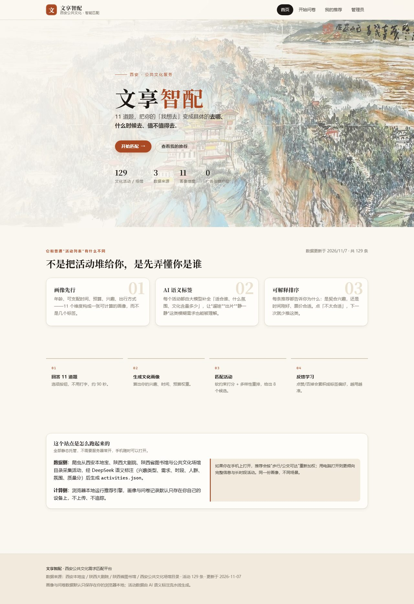
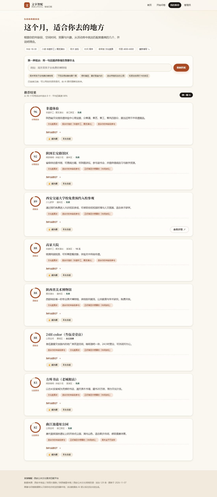
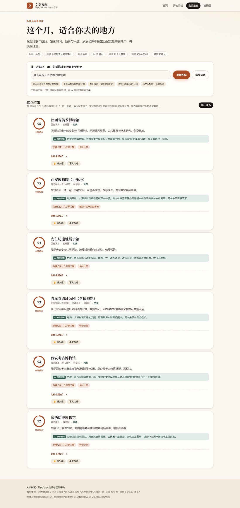
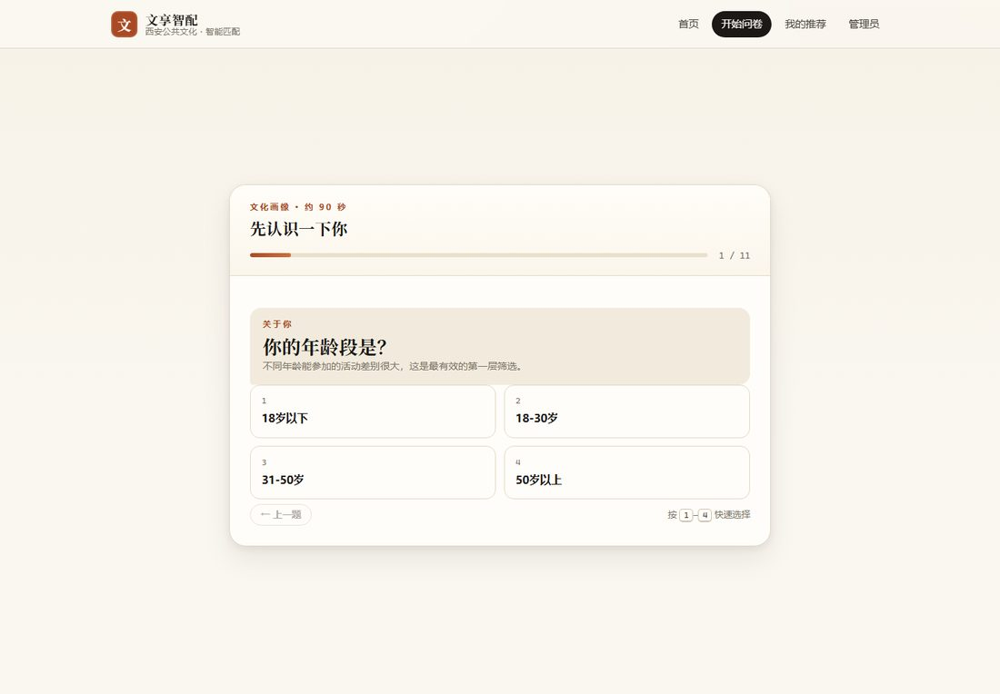
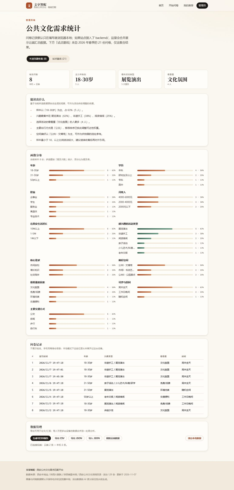

# 文享智配 · 西安公共文化需求匹配平台

用 11 道题生成一张「文化画像」，再从西安上百个公共文化活动与场馆里，
挑出**此刻最适合你**的几个，并说清楚为什么。

在线访问：<https://mmikuchua.github.io/wenxiang-website/>



| 推荐结果 | AI 顾问（一句话找活动） |
| --- | --- |
|  |  |

| 问卷 | 管理端 |
| --- | --- |
|  |  |

## 为什么这样部署

原来的版本是 FastAPI + SQLite + Jinja 模板，必须有一台开着的电脑（或 ngrok 隧道）才能访问。
这次改造后：

- **前端是纯静态站点**：`web/` 目录直接托管在 GitHub Pages，手机、平板、任何电脑随时打开；
- **推荐在浏览器里算**：没有后端也能出结果，响应是毫秒级；
- **后端变成可选增强**：想要「所有问卷汇总到一处」「自然语言问 AI 顾问」，再启动 `backend/`；
  前端会自动探测 `/api/health`，没有就安静地退回本地模式。

```
                    ┌──────────────────────────────┐
   GitHub Pages ───▶│ web/  静态站点（HTML/CSS/JS） │
                    │  engine.js 推荐引擎（本地算） │
                    └──────────────┬───────────────┘
                                   │ 可选：探测到后端时
                    ┌──────────────▼───────────────┐
                    │ backend/ FastAPI（可选）      │
                    │  SQLite 汇总 + DeepSeek 顾问  │
                    └──────────────────────────────┘
                                   ▲
   MyXianSpiderBot ─── activities.json（爬取 + LLM 语义标注）
```

## 功能

**居民端**

- 11 题画像问卷：选项按钮、键盘快捷键、上一题回退、条件跳题（未满 18 岁跳过收入题）；
- 推荐结果：匹配度环、3 条推荐理由、六维打分明细、地址/时间/费用/适合人群；
- 一句话找活动：`周末带孩子去免费的博物馆` → 本地意图解析；接入后端时改由大模型理解；
- 反馈学习：👍 / 不太合适会累积成标签亲和度，影响后续排序；
- 「换一批」轮换，避免每次都是同几个。

**管理员端**

- 样本量、主力年龄段、最热类型、最看重的因素；
- 11 个维度的分布图（纯 CSS，无图表库依赖）；
- 自动生成观察结论；低于 10 份时提示样本不足；
- 导出 CSV / JSON、导入合并、生成可打印报告；
- 「试点基线」：2026 年春季 21 份问卷的**聚合结果**（不含个人记录）。

## 推荐算法

旧版是「硬过滤 + 固定权重」：年龄/时间/预算不匹配就直接删掉，最后经常剩 0 条；
所有用户共用一组权重，也解释不了为什么推荐它。

现在改成四层：

1. **软约束**：年龄、时段、预算、距离不再一刀切，而是算一个 0–1 的适配度并做乘法折扣
   （例如年龄不符 ×0.62），保证「永远有结果」，但真正不可行的活动排不到前面；
2. **动态权重**：用户在问卷里选「最看重」的因素，会提高对应维度权重——
   选「免费/低费」时预算权重 +0.75，选「交通便利」时交通权重 +0.75；
3. **MMR 多样性重排**：每选一条就惩罚与已选活动相似的类型/主题/行政区，
   前 8 条不会全是同一种展览；展示的「匹配度」是扣掉多样性惩罚后的综合推荐度，
   所以列表顺序和百分比永远一致；
4. **可解释 + 可学习**：每张卡片给出命中的具体理由；点赞/否掉写入标签亲和度
   （`computeAffinity`，带阻尼，避免一票锁死偏好），下次排序自动生效。

对应实现：`web/assets/js/engine.js`（纯函数，18 个单元测试覆盖）。

## 数据从哪来

活动数据由数据仓库 [xian-activity-spider](https://github.com/mmikuchua/xian-activity-spider) 采集与标注。

| 数据源 | 类型 | 内容 | 可在 CI 抓取 |
| --- | --- | --- | --- |
| 豆瓣同城 · 西安 | 事件 | 演出/展览/脱口秀/活动，带档期、场馆、票价 | ✅ |
| 活动行 · 西安 | 事件 | 同城文化活动（已过滤商业培训/行业会议） | ✅ |
| 陕西省图书馆 | 活动 | 陕图讲坛讲座预告 | ✅ |
| 陕西历史博物馆 | 展览 | 临时展览（含展期、展厅） | ✅ |
| 西安本地宝 | 事件 | 活动日历（有拼图人机验证，HTTP 偶尔被拦） | ⚠️ 尽力而为 |
| 陕西大剧院 | 演出 | 演出列表（SPA，需要浏览器） | 仅本机 |
| 西安公共文化场馆目录 | 场馆 | 75 个常设文化场馆/空间 | 静态 |

**不做定时任务**。需要刷新数据时，到 Actions 页面手动运行 `Refresh activity data (manual)`，它会：

1. 抓取所有 HTTP 数据源；
2. 与现有活动库**增量合并**（某源失败不会丢数据，过期的自动淘汰）；
3. 只为新增/内容变更的活动调用 DeepSeek 打标（有内容哈希，不会重复烧钱）；
4. 校验数据 → 提交 `web/data/activities.json` → 直接发布到 Pages。

也可以指定数据源和本次最多标注条数；命令行等价操作：

```bash
cd ../xian-activity-spider
python -m xian_activities.cli update --all-sources
copy data\activities.json ..\wenxiang-website\web\data\activities.json
```

每个活动包含：类型/需求/舒适物/关注因素/年龄段/时段等问卷编码、LLM 生成的主题与人群标签、
文化含量/交通/环境/性价比/亲子友好等 0–1 评分，以及 40 字以内的客观简介。
页面底部会显示数据来源、条数与更新时间。

## 本地运行

纯静态（推荐，最接近线上）：

```bash
cd web
python -m http.server 8080
# 打开 http://localhost:8080
```

带后端（问卷汇总 + AI 顾问）：

```bash
python -m venv backend/venv
backend\venv\Scripts\activate
pip install -r backend/requirements.txt
copy .env.example .env          # 填 DEEPSEEK_API_KEY（可选）
uvicorn backend.main:app --reload --port 8000
# 打开 http://localhost:8000
```

## 测试

```bash
node --test web/tests/*.test.mjs
```

- `engine.test.mjs`：软约束不空结果、预算/年龄/时段排序、多样性、单调百分比、确定性、反馈学习；
- `data.test.mjs`：活动数据 schema、编码合法性、评分区间、类型/来源覆盖。

浏览器端到端自检（用本机 Edge 跑完整问卷，产出截图到 `.shots/`）：

```bash
node tools/browser-check.mjs http://127.0.0.1:8000
```

## 部署

| 方式 | 说明 |
| --- | --- |
| **GitHub Pages** | `.github/workflows/pages.yml`：push 到 `main` 自动发布 `web/`；`.github/workflows/refresh-data.yml`：手动触发更新数据并发布 |
| Render / Docker | `render.yaml` + `Dockerfile`，含可选的 FastAPI 后端 |
| Vercel / Netlify | 仓库内已放 `vercel.json` / `netlify.toml`，导入仓库即可，无需构建命令 |

Pages 首次启用：仓库 Settings → Pages → Source 选择 **GitHub Actions**。
手动刷新数据需要仓库 Secret `DEEPSEEK_API_KEY`（Settings → Secrets and variables → Actions）。

## 隐私

- 问卷答案默认只写在浏览器 `localStorage`，不上传、不追踪；
- 管理员页只显示本机数据；接入后端后才会有跨设备汇总；
- 试点基线只保留聚合计数，不含任何个人记录。

## 目录

```
web/                     # 线上部署的静态站点
  index.html survey.html recommend.html admin.html
  assets/js/engine.js    # 推荐引擎（纯函数）
  assets/js/questions.js # 问卷结构与显隐规则
  assets/js/store.js     # localStorage：画像/记录/反馈
  assets/js/intent.js    # 一句话需求解析
  assets/js/cloud.js     # 可选后端探测与调用
  assets/css/app.css     # 设计系统（无外部字体/CDN）
  data/activities.json   # 活动数据（按需刷新）
  data/pilot.json        # 试点问卷聚合基线
  tests/                 # Node 单元测试
.github/workflows/
  pages.yml              # push → 构建 → 发布
  refresh-data.yml       # 手动触发：抓取 → 合并 → AI 标注 → 发布
backend/                 # 可选 FastAPI：汇总 + AI 顾问
tools/                   # 数据导出、排序调试、端到端浏览器自检
docs/                    # 截图
```
